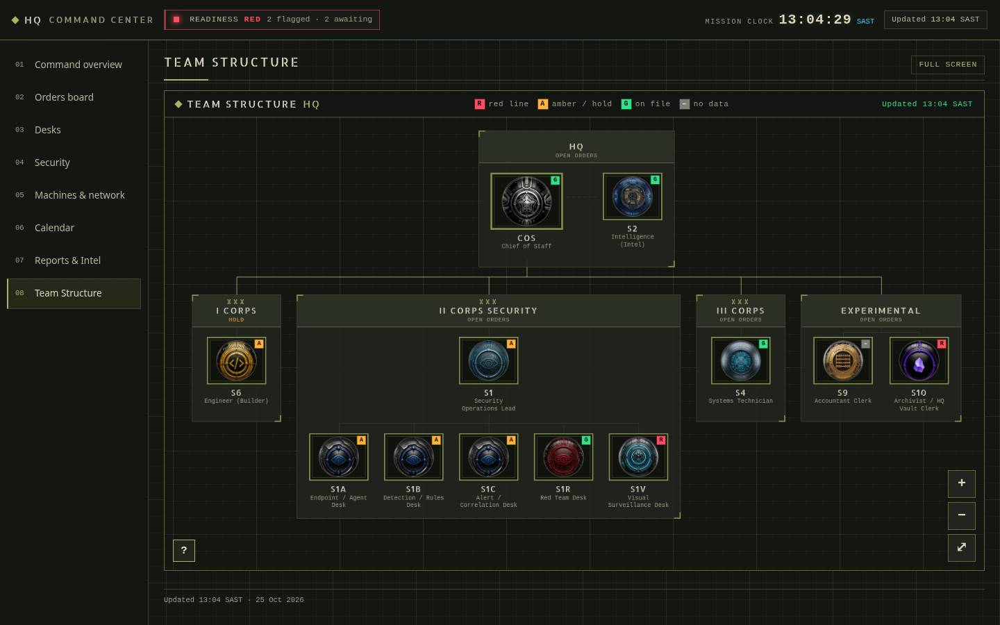

# Multi-Agent Orchestration (Grok Bots)

Hierarchical multi-agent system with a central orchestrator (Chief of Staff) and specialised desks.  
This repo demonstrates practical multi-agent design (clear boundaries, approval gates, structured status reporting) plus selected code samples from earlier systems.

## What this shows
- How to decompose recurring operational work into specialised agents with one owner per task.
- Use of reusable skills, scheduled routines, and explicit human approval gates.
- Structured status reporting so results are auditable without reading long logs.
- Selected production-style code samples from related projects.

## Architecture
- **COS (Orchestrator)** — owns the mission board, daily sitrep, and coordination of specialised desks.
- **Specialised desks**:
  - Security Ops — agent health, detection rules, alert correlation
  - Tech — host & network baselines, drift detection, scheduled health sweeps
  - Archivist — knowledge vault capture, formatting, and filing
  - Intel — structured research briefs
  - Clerk — operational document capture and allocation

## Key mechanisms
- Reusable skills (steps, decision rules, expected outputs, safety boundaries)
- Scheduled routines
- Explicit approval gates (“AWAITING APPROVAL”) for consequential actions
- Structured status reporting with file paths
- Clear written boundaries per agent

## Evidence
- [Case study (architecture + worked example)](Grok_Bots_Case_Study.pdf)
- Daily host & network health sweep with drift detection and approval gate (see case study)

## Code samples
Selected snippets from earlier systems are in the [`snippets/`](snippets/) directory:
- Ledger — money types, VAT logic, bank statement import, append-only journal
- HQ Dashboard — fail-closed redaction, org chart rendering
- Plaasboek — livestock database, validation, offline herd sync
- Aether Timetable — scheduler, clash detection, CSV import

## Contact
lightfootwilrich@gmail.com
